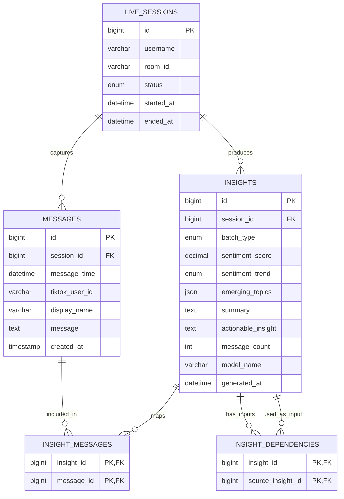

# Streamly — proposed final database ERD

## Scope based on current source

The backend currently collects TikTok chat into Redis (`TikTokScraper` -> `RedisRepository.pushMessage`), analyzes it in `AnalysisOrchestrator`, and stores bounded insight history in Redis (`RedisRepository.saveInsight`). The API endpoint `GET /api/insights` reads Redis. `DatabaseRepository` and its `messages`/`insights` schema exist, but the API composition root does not instantiate or inject it. Therefore, the current MySQL tables are not the durable data path yet.

The frontend/API currently identifies the monitored creator by `username`; `/api/login` starts a scraper and analysis, but it does not implement persistent application users or authentication. This ERD deliberately does not invent a `users` table. Add one only when real accounts/ownership are implemented.

## ERD (Mermaid)

## Table purpose and cardinality

- `live_sessions`: one row per run of a scraper against a creator's live stream. One creator may have many sessions over time.
- `messages`: durable raw chat messages. Each message belongs to exactly one session; a session can have zero or many messages.
- `insights`: durable AI output. Each insight belongs to one session and is categorized as `5m`, `20m`, or `45m`.
- `insight_messages`: traceability from a 5-minute insight to the raw messages analyzed. This is many-to-many because a message can be referenced by analysis records if the design later supports overlapping windows.
- `insight_dependencies`: traceability between generated insights. For example, a 20-minute insight can reference four 5-minute insights; a 45-minute insight can reference two 20-minute insights and one 5-minute insight.

## Important implementation rules

1. Generate a `live_sessions` row when monitoring starts; keep its `id` in the scraper/orchestrator context.
2. Save incoming messages to Redis as today for real-time processing. Persist the same messages to MySQL in batches, adding `session_id`. Use the same stable message object shape throughout (`message_time`, `tiktok_user_id`, `display_name`, `message`).
3. When an insight is generated, insert it into MySQL and obtain its inserted ID. Keep Redis history for low-latency access if useful.
4. For a `5m` insight, populate `insight_messages` with the IDs of the source messages. For `20m`/`45m` insights, populate `insight_dependencies` with the earlier insight IDs used as inputs.
5. Update session status and `ended_at` when scraping stops or the live ends.
6. Do not store a database password in source control. Use `.env` locally and secret variables in deployment.

## Design decisions

- `username` is the monitored TikTok creator, not an authenticated Streamly account.
- `batch_type` uses an ENUM matching current code values.
- `emerging_topics` is JSON because `StructuredInsight.emerging_topics` is a string array.
- `sentiment_score` is decimal and constrained to [-1, 1], matching the analyzer contract.
- `message_count` is an aggregate, not a replacement for message-level traceability.
- Redis remains the queue/cache. MySQL is the source of truth for durable history.
